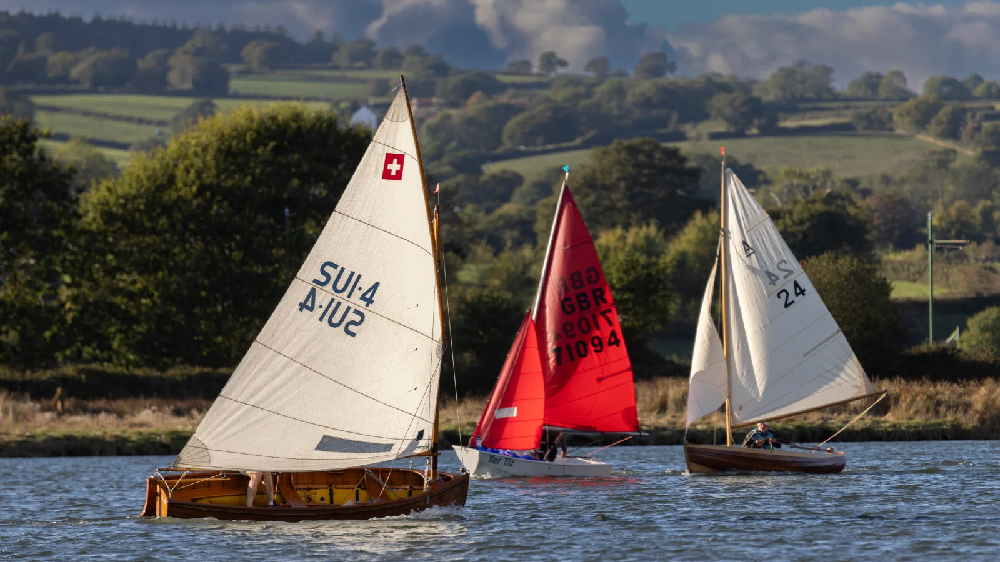

Test of two photos loaded in one go

Test of having same photo twice in post

Test of re-ordering photos

Test of embedded photo:



More te

```html
<table>
<tr>
<td>cell 1</td>
<td>cell 2</td>
</tr>
<tr>
<td>cell 3</td>
<td>cell 4</td>
</tr>
</table>
```
